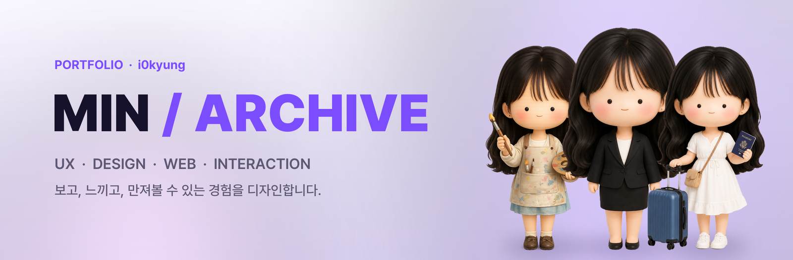
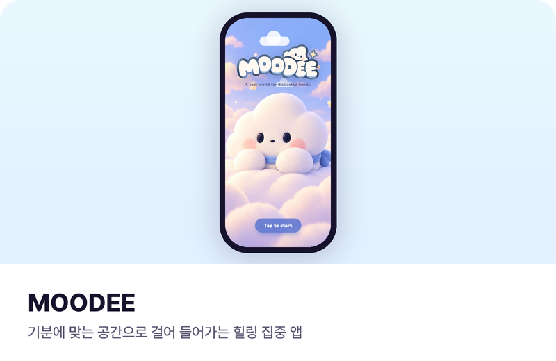
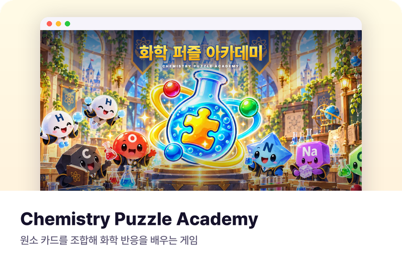
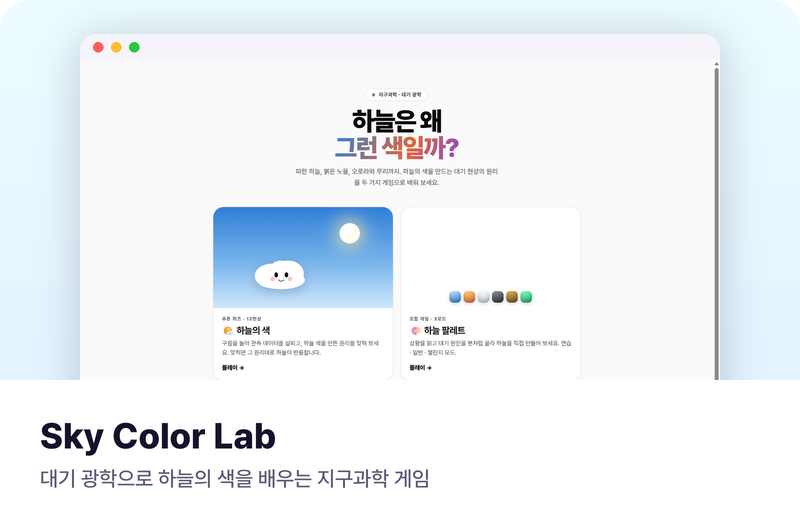
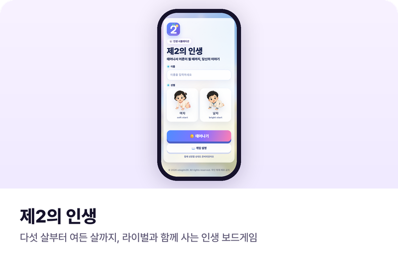
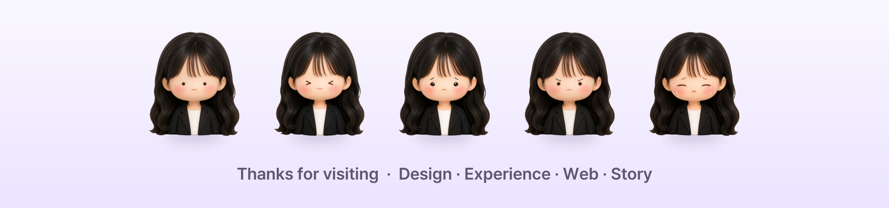

 

 

## ✦ About

Hi, I'm **MIN** — a designer who keeps a record of what I make.

I work across **UX/UI · Web · Interaction · Branding**.
When something catches my interest, I build it myself — web apps, games and prototypes —
so an idea can become an experience people can actually see, feel and play with.

> **Observe → Understand → Design → Build**

 

## ✦ Selected Projects

<table>
<tr>
<td width="50%" valign="top">

 <code>UX/UI</code> <code>Web App</code> <code>Hackathon</code>
</td>
<td width="50%" valign="top">

 <code>Game Design</code> <code>Education</code> <code>Web</code>
</td>
</tr>
<tr>
<td width="50%" valign="top">

 <code>Interaction</code> <code>Education</code> <code>Web</code>
</td>
<td width="50%" valign="top">

 <code>Board Game</code> <code>Mobile Web</code> <code>Story</code>
</td>
</tr>
</table>

카드를 누르면 실제 사이트가 열려요.

 

## ✦ What I Do

| Design | Build | Story |
|:--|:--|:--|
| UX / UI Design | Web Design & Creative Coding | Branding & Character |
| Product & Service Design | Game UI · Interactive Experience | Presentation Design |
| Industrial Design | Prototyping | AI-assisted Creation |

 

## ✦ Tools

  
  &nbsp;&nbsp;
  

 

## ✦ Now

- 🌱 UX/UI & Interactive Experience
- 🎮 Web-based Game Projects
- 🧩 Creative Coding

 

© MIN / i0kyung · Characters & works by MIN. All rights reserved.

